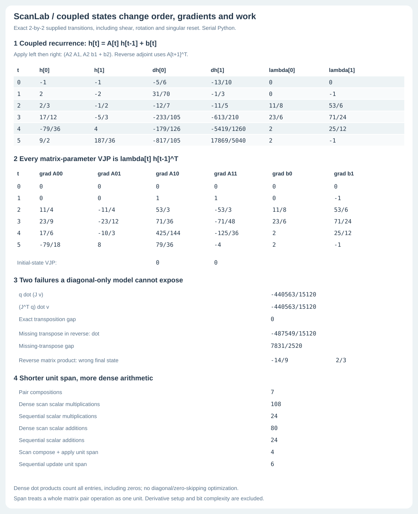
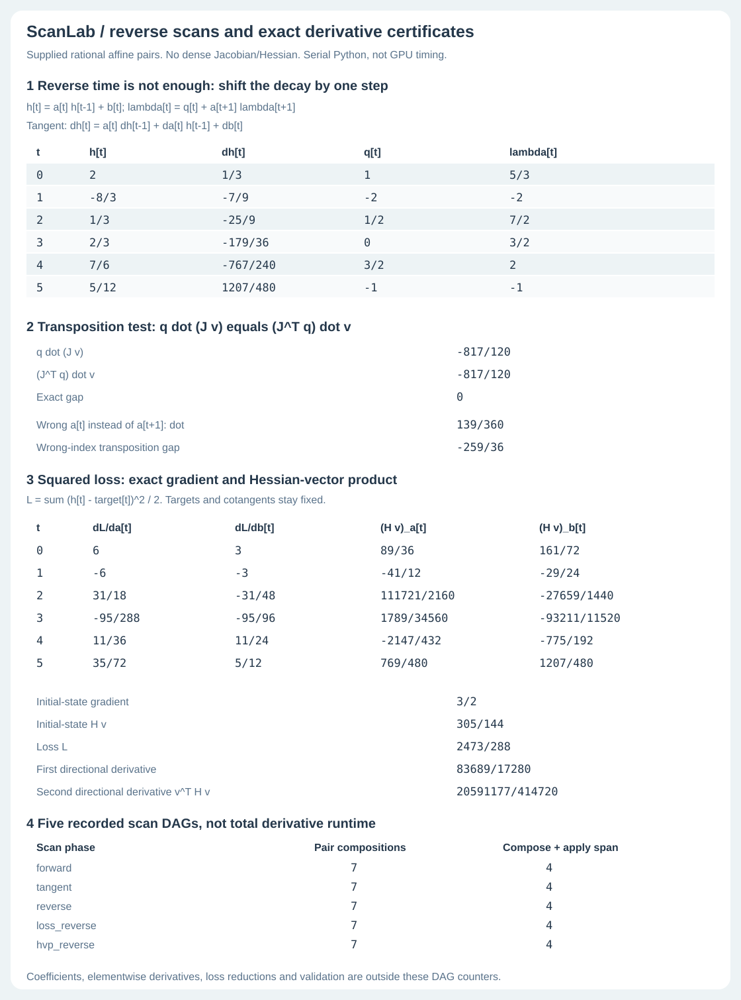
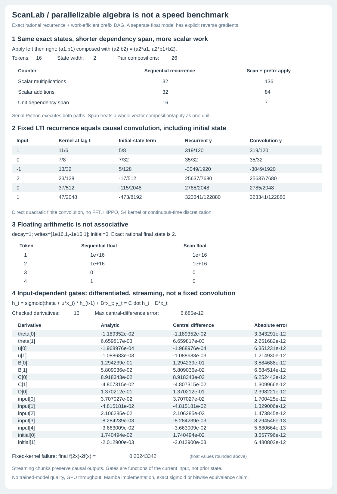

# ScanLab

ScanLab compares sequential state updates with associative prefix scans. It
returns exact rational states, dependency graphs, arithmetic counts and
derivative checks for diagonal and small full-matrix recurrences. A separate
floating-point model shows input gating, streaming and rounding failures.
It uses only Python's standard library.

These are inspectable reference calculations, not a trained sequence model or
a speed benchmark. Every operation runs serially in Python.

## Commands

| Command | What it returns |
|---|---|
| `python -m scanlab demo` | Diagonal scan, LTI convolution, float failures and gated-model derivative checks. |
| `python -m scanlab audit examples/input.json` | Exact diagonal states, scan graph and work/span counts for supplied pairs. |
| `python -m scanlab adjoint-demo` | Saved diagonal JVP, VJP and squared-loss Hessian-vector checks. |
| `python -m scanlab adjoint examples/adjoint-input.json` | Those diagonal derivative checks for supplied coefficients, directions, cotangents and targets. |
| `python -m scanlab dense-demo` | Saved full-matrix states, derivatives, operation counts and failure controls. |
| `python -m scanlab dense examples/dense-input.json` | Full-matrix audit for supplied transitions, directions and cotangents. |

## Coupled dense states



The exact full-matrix path mixes state coordinates rather than assuming
diagonal dynamics. Noncommuting affine composition, singular reset steps,
transposed next-matrix adjoints, outer-product matrix gradients and full
parameter JVP/VJP certificates are all exposed. The transpose identity is
`-440563/15120` on both sides. Omitting the reverse transpose gives exact gap
`7831/2520`; reversing only matrix-product order changes the final state from
`[9/2,187/36]` to `[-14/9,2/3]`. Controls can be invisible on special inputs.

Small dense scans are not cheap diagonal scans. On six two-state steps,
unit-pair dependency span is 4 versus sequential 6, but multiplications rise
24 to 108 and additions 24 to 80. Instrumented exact arithmetic checks actual
operation calls on 51 cases. Each dense composition costs cubic work in state
width, and a whole matrix operation is only one span unit by convention.
No timing, trained-model or hardware-speed claim.

[Derivation, counters, strict contracts and six sources](DENSE.md). 96
homogeneous-product length/width cases, 672 independently polynomial-checked
parameter coordinates across 36 models, 24 full directional models, 216
associativity cases and every DAG length through 32 support this extension.
The dense path is bounded to length 32 and width 4; the earlier diagonal and
diagonal-HVP paths remain unchanged. This is not a dense-HVP implementation.

```bash
python -m scanlab dense-demo
python -m scanlab dense examples/dense-input.json
bash examples/dense-demo.sh
```

## Exact reverse scans and curvature



The exact diagonal path differentiates the supplied diagonal affine pairs, separately
from the float gated model below. Shifted-decay reverse scans return every
parameter VJP; tangent scans return every state JVP. The exact dot-product
identity is `-817/120 = -817/120`. A deliberately wrong reverse index produces
`139/360`, exposing a gap of `-259/36` on this fixture. Zero-direction controls
also show why this test alone is not a universal correctness proof.

A hand-written forward-over-reverse path computes the squared-loss gradient
and Hessian-vector product without constructing either dense matrix. The loss
is `2473/288`, first directional derivative `83689/17280`, and second
`20591177/414720`. Independent bivariate polynomial expansion checks all
**432 parameter coordinates** across 36 models, including each HVP coordinate,
plus 24 full directional checks and 24 Hessian symmetry checks. Independent
future-decay product sums check adjoints on another 51 models.

[Derivation, exact contracts and six attributed sources](ADJOINT.md).
Established scan-AD techniques, not a new algorithm, general AD engine,
trained model or GPU benchmark. Five separate scan DAGs are recorded; their
counters exclude coefficient construction, loss reductions and gradient
products, and are not end-to-end derivative latency. All v0.1 saved evidence
and behavior below are preserved.

```bash
python -m scanlab adjoint-demo
python -m scanlab adjoint examples/adjoint-input.json
bash examples/adjoint-demo.sh
```



## What the comparisons show

- **Same exact states, different dependency graph.** For the 16-token,
  two-state rational fixture, sequential recurrence and scan agree exactly.
  The scan performs 26 pair compositions. Unit composition/apply span drops
  from 16 to 7, while scalar multiplications increase from 32 to 136 and
  additions from 32 to 84. Both run serially in Python. Span is not latency,
  scalar counts are not arbitrary-precision bit complexity, and there is no
  GPU or throughput claim.
- **Convolution needs fixed dynamics.** The fixed diagonal LTI path exactly
  matches direct causal convolution, including nonzero initial state and
  skip connection. An input-dependent gate breaks superposition by
  `0.20243342` on the explicit control, so a single fixed linear convolution
  cannot represent that model on all inputs. The supplied convolution is
  direct quadratic work, not an FFT or an S4 kernel implementation.
- **Real algebra is not floating arithmetic.** With writes
  `[1e16,1,-1e16,1]`, decay 1 and initial 0, sequential floats finish at 1,
  the same scan DAG finishes at 0, and exact rational algebra finishes at 2.
  No bitwise or exact-sigmoid equivalence claim is hidden behind a tolerance.
- **Differentiated, not benchmarked as a trained model.** The input-gated model
  exposes every state, gate, output, parameter gradient, input gradient and
  initial-state gradient. All 123 derivative probes across nine shapes pass
  independent central differences. The displayed 16-probe fixture has maximum
  error about `8.419e-12`. All 64 chunk partitions of a seven-token input
  preserve the causal streaming outputs. A tested descent step reduces the
  fixture loss; no learned-task, language-model or generalization claim.

## Tests and input contracts

```bash
python -m scanlab demo
python -m scanlab audit examples/input.json
python -m unittest discover -s tests -v
bash examples/demo.sh
python examples/render_demo.py --check
```

63 tests (30 original, 16 exact-diagonal derivative and 17 dense-state) include 729 scalar affine associativity cases, 264 length/width cases
against a closed-form expansion, 120 LTI models, full DAG scope/dependency/count
checks, every length through 128 for work/span bounds, 123 independent gradient
probes, 64 streaming partitions, strict input errors and both real failure
controls. The 114-cell figure binds the complete report, including hidden
intermediate factors, not only headline numbers. Five CI jobs check Python
3.10-3.13 plus all six commands from an installed nine-module wheel outside checkout.
The 68-cell adjoint SVG binds every shown value and embeds all five full scan
DAGs; the original 114-cell figure is unchanged.

```python
from scanlab.exact import audit
from scanlab.lti import compare
from scanlab.gated import forward, loss_and_grad, streaming

certificate = audit(
    [{"decay": ["1/2"], "write": [1]},
     {"decay": ["3/4"], "write": [-1]}],
    initial=["1/3"],
)
```

The strict JSON audit input has exactly `pairs` and `initial`; each pair has
exactly `decay` and `write`, vectors matching the 1..8 state width. Sequence
length is 0..128. Exact numbers are integers or rational/decimal strings
(Python API also accepts `Fraction`), never floats/bools. String length <=80,
input numerator/denominator <=128 bits, payload <=1 MB. Unknown/duplicate keys,
nonfinite JSON and invalid shapes fail with exit 2 and empty stdout. Internal
rational results may grow beyond the input bound. The separate float model
accepts finite float/int inputs and parameters of magnitude <=100, not bools;
its input-independent state width is 1..8 and sequence length <=128.

[Mathematics, derivative equations, count contract, source notes and limits](NOTES.md).

This code is written here, with the scan/state-space literature attributed.
It is **not Mamba, S4, a GPU kernel, a trained sequence benchmark, an exact
floating reduction, or a new scan algorithm**. It uses a simple input-sigmoid
gate, not Mamba's input-dependent continuous-time discretization or full block.
MIT licensed.
